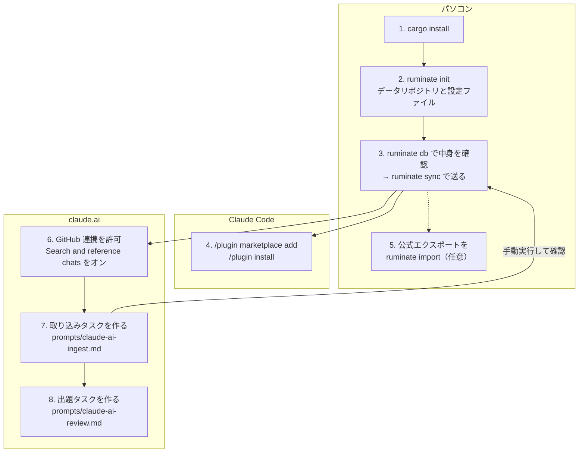

# ruminate

AIエージェントとの会話を自分の非公開リポジトリにためて、あとから振り返る（反芻する）ためのツールです。

- ターミナルの Claude Code の会話を、会話が終わるたびに自動で非公開のデータリポジトリへ送ります
- たまった会話は DuckDB でそのまま検索できます（`ruminate db`）
- 毎晩の振り返りタスク（claude.ai のスケジュールタスク）が、このデータから復習問題を出します

設計の背景は [docs/design.md](docs/design.md) にあります。

## 仕組み

```
Claude Code の会話 ──(プラグインのフック)──> ruminate sync ──┐
claude.ai / ChatGPT のエクスポート ────> ruminate import ──┴─> ruminate-data（Private）
                                                              ├─ logs/<agent>/YYYY/MM/*.jsonl
                                                              └─ review/*.jsonl（振り返りタスクが書く）
```

- 送るのは、あなたの発言と Claude の返答の文章だけです。ツールの実行結果・思考・画像・サブエージェントの会話は送りません
- ツールの操作は `Edit: src/main.rs` のような1行にまとめます
- APIキーやトークン、電話番号らしい文字列は `[REDACTED]` に置き換えます。電話番号は半角で、携帯・IP電話・フリーダイヤル・ハイフン区切りの固定電話・`+81` 形式が対象です（全角や `03(1234)5678` は対象外）。完全ではないので、気になるプロジェクトは `exclude_projects` で除外してください
- 長いコードブロックは先頭 40 行だけ残します

## セットアップの全体像

手でやることが多いので、順番を先に示します。実線は必須、点線は任意です。



| 番号 | 書いてある場所 |
|---|---|
| 1〜3 | この下の「セットアップ」 |
| 4 | 同じく「セットアップ」の最後 |
| 5 | 「claude.ai や ChatGPT の会話を取り込む」 |
| 6〜8 | [prompts/README.md](prompts/README.md) |

## セットアップ

必要なもの: Rust（`cargo`）、`git`、データリポジトリに push できる GitHub の認証。`gh` があればリポジトリ作成も自動、`duckdb` があれば `ruminate db` が使えます。

```sh
# 1. インストール
cargo install --git https://github.com/futabooo/ruminate

# 2. データリポジトリと設定ファイルを用意して、これまでの会話を変換（まだ送らない）
ruminate init --create ruminate-data      # gh で非公開リポジトリを作る
# または
ruminate init --repo git@github.com:<あなたのアカウント>/ruminate-data.git

# 3. 中身を確認して、問題なければ送る
ruminate db
ruminate sync
```

Claude Code にプラグインを入れます。会話の終わり（SessionEnd）と始まり（SessionStart）に、裏で `ruminate sync` が動きます。

```
/plugin marketplace add futabooo/ruminate
/plugin install ruminate@ruminate
```

## コマンド

| コマンド | すること |
|---|---|
| `ruminate init` | データリポジトリの用意、設定ファイルの作成、これまでの会話の変換 |
| `ruminate sync` | 新しい・更新された会話を変換して push。`--dry-run` で確認だけ、`--no-push` で送らない、`--all` で全件を作り直す（伏せ字ルールを変えたあとなど） |
| `ruminate import <FILE>...` | claude.ai・ChatGPT の公式エクスポート（`conversations.json`）を変換して push。形式は中身から判別。`--dry-run` / `--no-push` は `sync` と同じ |
| `ruminate hook` | プラグインのフックから呼ばれる。すぐ戻り、裏で `sync` を動かす |
| `ruminate db` | ビューを用意した状態で DuckDB を開く。`ruminate db -ui` でブラウザのUI |

## claude.ai や ChatGPT の会話を取り込む

公式のエクスポート（claude.ai: 設定 → プライバシー → データをエクスポート、ChatGPT: 設定 → データコントロール → データをエクスポート）の ZIP を展開し、中の `conversations.json` を渡します。

```sh
ruminate import --dry-run ~/Downloads/data-2026-10-28/conversations.json   # 何が書かれるか見る
ruminate import ~/Downloads/data-2026-10-28/conversations.json             # 変換して送る
```

- 残すのは本人の発言と返答の文章、ツール操作の1行要約（`web_search: …`、`python: …`）、添付ファイルの名前だけです。添付の中身・思考・ツールの結果・画像は送りません
- ChatGPT は、編集や再生成で枝分かれした会話のうち、最後に表示していた枝だけを読みます
- 会話の開始時刻と ID からファイル名が決まるので、あとで新しいエクスポートを取り込み直すと同じファイルが上書きされます
- 伏せ字と長いコードの切り詰めは `sync` と同じです

## claude.ai のタスクを作る

claude.ai の新しい会話を毎日拾う取り込みタスクと、復習問題を出す出題タスクは、claude.ai のスケジュールタスクとして動きます。作り方と貼る手順書は [prompts/README.md](prompts/README.md) にあります。

## 設定

`~/.config/ruminate/config.toml`（例: [docs/config.example.toml](docs/config.example.toml)）

```toml
data_repo = "git@github.com:<あなたのアカウント>/ruminate-data.git"
clone_dir = "~/.local/share/ruminate/data"
exclude_projects = ["work-*"]
code_max_lines = 40
redact_patterns = []
project_patterns = []
```

プロジェクト名は起動したフォルダから決めます。git の worktree（`<repo>/.claude/worktrees/<名前>` や `~/.herdr/worktrees/<repo>/<名前>`）はもとのリポジトリ名に、サブフォルダはそのリポジトリ名になります。ほかの置き方をしているなら `project_patterns` に `(?P<repo>...)` を含む正規表現を足してください。

パソコンの中だけの状態（送信済みの記録・ロック・ログ）は `~/.local/state/ruminate/` にあります。バックグラウンドの同期の結果は `sync.log` に出ます。

## DuckDB で見る

```sh
ruminate db
```

```sql
-- 最近の会話
SELECT agent, title, project, started_at, prompts FROM sessions ORDER BY started_at DESC LIMIT 20;

-- キーワードで探す
SELECT date, title, role, left(text, 80) FROM messages WHERE text ILIKE '%ライフタイム%';

-- 約1週間前の会話
SELECT DISTINCT title FROM messages
WHERE date BETWEEN now() - INTERVAL 8 DAY AND now() - INTERVAL 6 DAY;
```

ビューの定義は [duckdb/init.sql](duckdb/init.sql) です。

## ログの形式

1会話1ファイル、1行に1ターン（あなたの1回の発言、または次の発言までの Claude の返答ひとまとまり）。

```json
{"agent":"claude-code","channel":"cli","session":"…","title":"Rust: ライフタイムの読み方","project":"my-app","git_branch":"main","url":null,"date":"2026-10-27T11:00:00Z","seq":0,"role":"user","text":"ライフタイム注釈はいつ必要？"}
```

会話が続いて元のファイルが伸びたら、そのファイルを丸ごと作り直します。

## 開発

```sh
cargo test
claude --plugin-dir plugin    # プラグインを手元のファイルから読み込んで試す
claude plugin validate plugin
```

Claude Code の会話ファイルの形式は内部仕様で、バージョンによって変わります。読み込みは `src/source/claude_code.rs` にまとまっていて、知らない行は飛ばします。会話ファイルの読み方は [claude-recall](https://github.com/babarot/claude-recall)（MIT）を参考にしました。

## ライセンス

MIT
